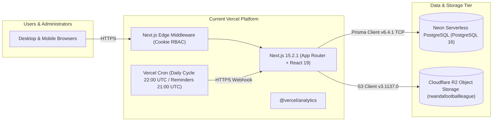
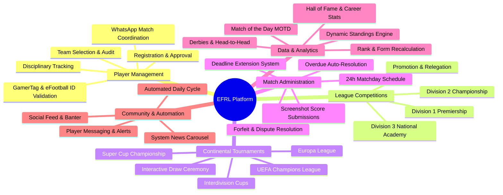
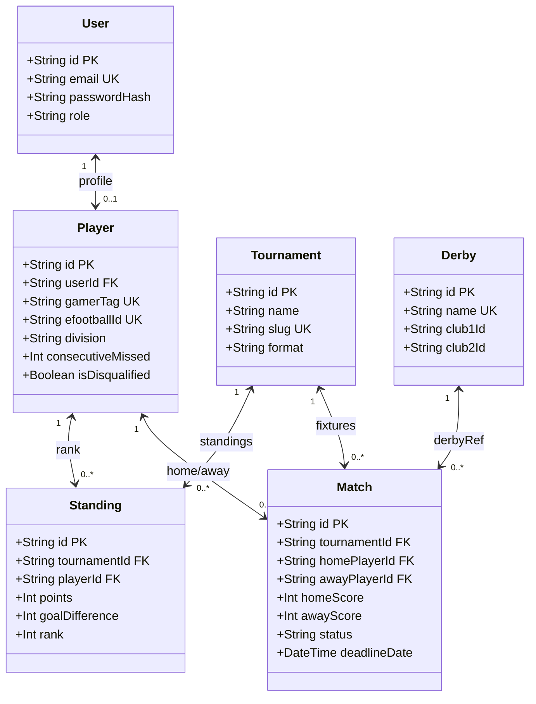
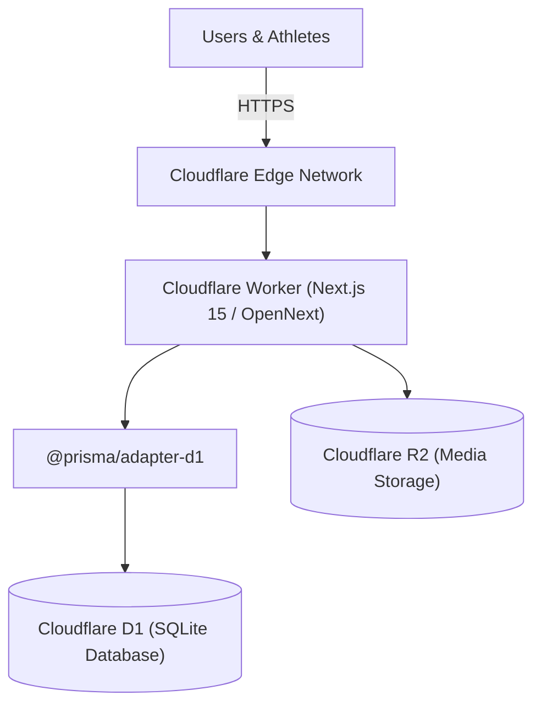
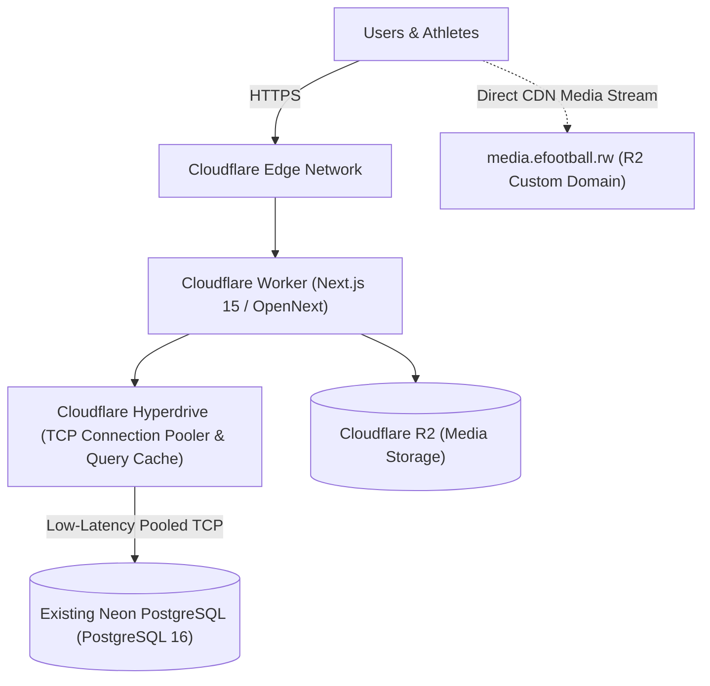
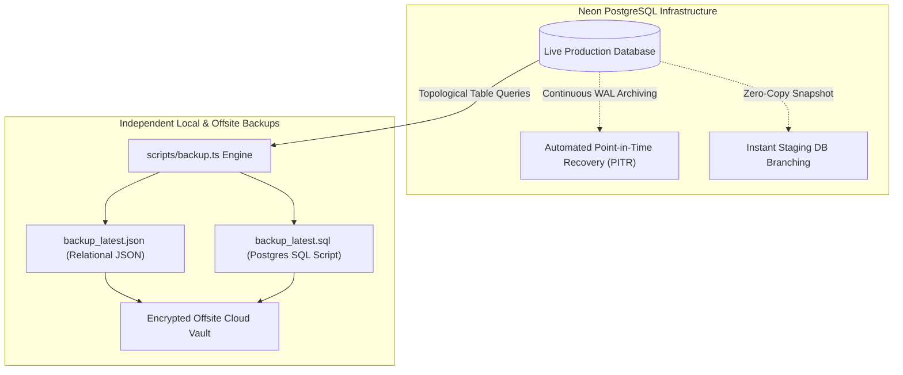
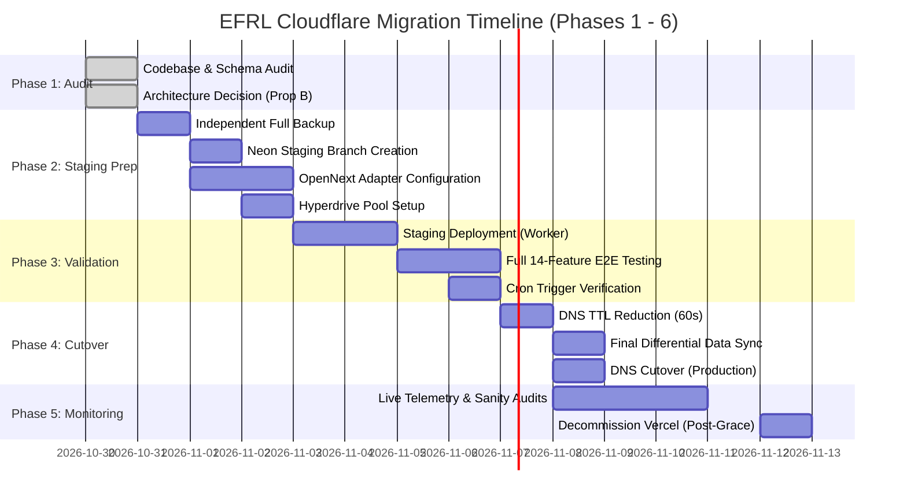

# Rwanda eFootball League (EFRL) — Cloudflare Migration Assessment & Phase 1 Audit

**Project**: Rwanda eFootball League (efootball.rw)  
**Document Type**: Phase 1 Technical Audit, Database Architecture Assessment & Migration Strategy  
**Current Date**: October 2026  
**Auditor**: Senior Full-Stack Architect, Database Architect & Cloudflare Migration Specialist  
**Status**: DRAFT FOR STAKEHOLDER REVIEW (Phase 1 — No Production Changes Applied)

---

## Executive Summary

The Rwanda eFootball League (EFRL) is a mission-critical, live production sports platform powering competitive eFootball esports in Rwanda. It manages 3 league divisions (Division 1 Premiership, Division 2 Championship, Division 3 National Academy), prestigious continental tournaments (UCL, Europa League, Super Cup), real-time standings, match scheduling with 24-hour enforcement windows, proof screenshot uploads, admin dispute resolution, social feeds, and historical Hall of Fame records.

This technical audit comprehensively evaluates migrating the EFRL platform from its current stack (**Vercel + Neon PostgreSQL + Prisma + Next.js 15 + Cloudflare R2 via AWS SDK**) to a pure Cloudflare ecosystem.

### Core Recommendation: Architecture Proposal B
**Deploy Next.js 15 to Cloudflare Workers via OpenNext, accelerate the existing Neon PostgreSQL database via Cloudflare Hyperdrive, and retain Cloudflare R2 for media assets.**

> [!CAUTION]
> **Cloudflare D1 is NOT recommended for EFRL production.**  
> Migrating from PostgreSQL to Cloudflare D1 (SQLite) would introduce severe structural risks:
> 1. SQLite lacks PostgreSQL native array types (`String[]` in `SocialPost.hashtags`), which causes fatal Prisma schema validation failures.
> 2. SQLite does not support `TIMESTAMP(3)` or `ALTER TABLE ... ADD COLUMN IF NOT EXISTS` used directly in EFRL's dynamic database services (`derbyService.ts`, `ensureNewsTable.ts`, `passwordReset.ts`).
> 3. D1 operates as a single-writer SQLite engine. The EFRL daily cycle cron and matchday crunch perform heavy transactional batch updates across 20+ standings records and match schedules simultaneously, introducing high risks of database write lock contention and request timeouts.
> 4. Hyperdrive delivers near-instant connection pooling and query caching for PostgreSQL directly from Workers without changing a single database column or application business rule.

---

## 1. Current Architecture & Stack Audit

### 1.1 Infrastructure Topology


### 1.2 Technology Stack Inventory
| Component | Current Technology | Version | Location / Config |
| :--- | :--- | :--- | :--- |
| **Framework** | Next.js (App Router, Server Components) | `15.2.1` | `package.json`, `next.config.ts` |
| **Runtime Library** | React / React DOM | `19.0.0` | `package.json` |
| **Styling & UI** | Tailwind CSS v3 + shadcn/ui + Radix UI | Tailwind `3.4.17` | `tailwind.config.ts`, `src/app/globals.css` |
| **Animations** | Framer Motion | `13.4.2` | `package.json` |
| **ORM / Query Engine** | Prisma ORM | `6.4.1` | `prisma/schema.prisma`, `src/lib/prisma.ts` |
| **Database** | Neon Serverless PostgreSQL | PostgreSQL 16 | `DATABASE_URL` (pooled connection) |
| **Object Storage** | Cloudflare R2 (S3-compatible API) | `@aws-sdk/client-s3 3.1137.0` | `src/lib/r2.ts` |
| **Application Hosting** | Vercel Serverless | Node.js runtime | `vercel.json` |
| **Session & Auth** | Cookie-based session (`efrl_session`, `efrl_role`) | Node `crypto.pbkdf2Sync` | `src/lib/auth.ts`, `src/middleware.ts` |
| **Scheduled Jobs** | Vercel Crons | 2 daily jobs | `vercel.json` |

### 1.3 Deployment & Build Configuration
- **Build Script**: `prisma generate && next build`
- **Database Synchronization**: `prisma db push` (No historical migrations folder exists; the schema was managed via declarative `db push` and custom self-healing SQL initialization routines).
- **Static Assets & Media**: Uploads are stored in Cloudflare R2 bucket `rwandafootballleague` and streamed via `/api/files/[...key]` or served via `R2_PUBLIC_URL`.
- **Node.js Runtime Quirks**:
  - `src/lib/prisma.ts` line 2 imports Node built-in `dns` to execute `dns.setDefaultResultOrder("ipv4first")`. This module is incompatible with standard Cloudflare Worker isolates.

---

## 2. Complete EFRL Feature Inventory

The audit revealed an extensive, sophisticated esports management platform comprised of **14 interconnected subsystems**:



### 2.1 Player Registration, Accounts & Profiles
- **User Authentication**: Email/password registration with role-based segregation (`ADMIN` vs `PLAYER`).
- **Profile Onboarding**: GamerTag uniqueness, mobile eFootball ID verification, mandatory Rwandan WhatsApp contact number, country identification (`RW`), and personal quote.
- **Club Assignment**: Real club assignment (Premier League, La Liga, Serie A, etc.) with strict collision-prevention audits (`/api/admin/teams/audit` and `/api/admin/teams/reset`).
- **Disciplinary Ledger**: Automatic calculation of consecutive missed matches. 3 consecutive unplayed matches triggers automated disqualification (`isDisqualified = true`) and walkover awarding.
- **Password Recovery**: Admin-vetted password reset pipeline (`PasswordResetRequest`) with request, review, approve, and reset lifecycle.

### 2.2 League Divisions (D1, D2, D3) & Progression
- **Three-Tier Pyramid**: Division 1 (Premiership), Division 2 (Championship), and Division 3 (National Academy).
- **Matchday Scheduling Engine**: Round-robin fixture generator creating 24-hour matchday windows expiring at Rwandan midnight (22:00 UTC / 00:00 CAT).
- **Season Rollover & Promotion/Relegation**: Automated end-of-season promotion of top Division 2/3 finishers into higher tiers and demotion of bottom finishers (`src/lib/seasonPromotion.ts`).

### 2.3 Continental Tournaments & Special Competitions
- **UCL (Champions League)**: Elite competition featuring top division qualifiers.
- **Europa League**: Secondary continental competition with group stage and knockout playoffs.
- **Super Cup**: Annual clash between the Division 1 League Champion and the Continental Champion (`src/lib/superCupService.ts`).
- **Interdivision Cups**: Cross-tier knockout tournaments linking D1, D2, and D3 athletes.
- **Interactive Draw Ceremony Experience**: Full frontend experience (`ContinentalDrawExperience.tsx`) featuring custom sound effects (`drawAudio.ts`), real-time group slot assignments (`UclGroupSlot`), and live trophy prediction polls (`TrophyPollVote`).

### 2.4 Fixtures, Match Submissions & Dispute Resolution
- **Match Submissions**: Players submit home/away scores and upload mandatory proof screenshots stored in Cloudflare R2 (`MatchSubmission`).
- **Admin Verification**: Instant review queue to approve scores, adjust goals, or reject fraudulent reports.
- **Forfeit Claims**: Formal claims filed with proof screenshots (`ForfeitClaim`) for uncooperative or absent opponents.
- **Late Submissions & Extensions**: Admin ability to grant 24-hour match deadline extensions (`allowLateSubmission`, `extendedDeadlineDate`).
- **Matchday Overview Tool**: High-productivity bulk scoring and schedule management dashboard for league administrators (`/admin/matchday-overview`).

### 2.5 Dynamic Standings & Table Publisher
- **Standings Computation Engine**: Algorithmic recalculation (`src/lib/recalculateStandings.ts`) calculating Points, Goal Difference, Goals For, Goals Against, Wins, Draws, Losses, and last 5 match form (`W,D,L,W,W`).
- **Live Visual Publisher**: Generates shareable branded graphic representations of the standings table for WhatsApp community broadcasts (`AdminLeagueTablePublisher.tsx`).
- **Unread Update Indicators**: Tracks whether players have viewed the latest standings revision (`UserStandingsView`).

### 2.6 Match of the Day (MOTD), Match of the Week (MOTW) & Derby System
- **Algorithmic MOTD**: Analyzes standings, table proximity, and historic rivalry factors to crown the daily marquee clash (`src/lib/matchOfTheDay.ts`).
- **MOTD Prediction Polls**: Interactive community betting/prediction poll (`MotdPollVote`) for players and guests (`HOME`, `DRAW`, `AWAY`).
- **Historic Derby Engine**: Dedicated rivalries table (`Derby`) tracking classic football clashes, historic head-to-head metrics, and automated narrative social threads.

### 2.7 Social Feed & Engagement Engine
- **Automated Match Social Graphics**: Dynamically renders social match cards (`SocialPostCard.tsx`, `SocialGraphicRenderer.tsx`).
- **Community Reactions & Banter**: Registered athletes react (`SocialReaction`) and exchange banter comments (`SocialComment`) on match threads.
- **Social Automation Setting**: Configurable toggles for auto-publishing MOTD announcements, final scores, and rivalry discussions.

### 2.8 Hall of Fame & Historical Archives
- **Career Statistical Aggregator**: Precomputes and caches all-time win rates, total goals, clean sheets, and trophy cabinets across all seasons (`HallOfFameStatsCache`, `src/lib/hallOfFameStatsService.ts`).
- **Manual Historical Records**: Curated Hall of Fame inductees, historical records, and pre-digital league milestones (`ManualHistoricalRecord`).
- **Season Archives**: Immutable snapshot preservation of concluded tournaments, historical player stats, and match scoreboards (`ArchivedSeason`, `ArchivedMatch`, `HistoricalSeasonSnapshot`).

### 2.9 News & Announcements Hub
- **Dynamic Newsfeed**: News articles with featured banners, target action buttons, and publication windows (`News`).
- **Auto-Sync System News**: Automatically crafts system news cards based on active league milestones (`src/lib/systemNewsService.ts`).
- **Broadcast & Individual Announcements**: Direct alerts delivered to athletes with read-receipt confirmations (`Announcement`, `AnnouncementRead`).

### 2.10 Automated Daily Cycle & Cron Operations
- **Vercel Crons**:
  - `0 21 * * *` (`/api/cron/reminders`): Sends 1-hour deadline alerts to players with pending fixtures.
  - `0 22 * * *` (`/api/cron/daily-cycle`): Closes expired matches, registers 0-0 unplayed draws, increments missed match counts, auto-disqualifies repeat absentees, recalculates standings, and advances to the next round.

---

## 3. Database Schema Assessment

The EFRL PostgreSQL database contains **33 relational models**, organized into three functional layers:



### 3.1 Model Classification & Relational Hierarchy

#### 1. Core Identity & Player Governance (5 Models)
- `User`: Base authentication credentials, password hashes, and system roles.
- `Player`: Rich player profile, eFootball Mobile ID, gamerTag, WhatsApp handle, division, disciplinary metrics.
- `PlayerMessage`: Direct inquiries and feedback between players and admins.
- `FeedbackReview`: 5-star ratings and categorical league reviews submitted by athletes.
- `PasswordResetRequest`: Audit log and token store for secure password reset approvals.

#### 2. Competitions, Fixtures & Results (9 Models)
- `LeagueConfig`: Global season settings, matchday counters, division size caps, draw states.
- `Tournament`: Division leagues (D1, D2, D3), UCL, Europa League containers.
- `Match`: Core match entity with 2-leg aggregates, deadlines, MOTD flags, and derby links.
- `Standing`: Real-time league table record with composite unique constraint `@@unique([tournamentId, playerId])`.
- `StandingsUpdate`: Version hashing for standings table refreshes.
- `UserStandingsView`: Per-user read tracking for standings notifications.
- `MatchSubmission`: Proof screenshots and self-reported scores awaiting admin approval.
- `ForfeitClaim`: Dispute claims filed with photographic evidence.
- `UclGroupSlot`: Continental tournament group seeding.

#### 3. Rivalries, Social & Community (6 Models)
- `Derby`: Rivalry definitions between real clubs with historic rivalry metadata.
- `MotdPollVote`: Community match winner predictions.
- `TrophyPollVote`: Continental tournament champion predictions.
- `SocialPost`: Automated or manual league news cards with array tags (`hashtags String[]`).
- `SocialReaction`: Athlete reactions to social posts.
- `SocialComment`: Comments and opponent banter on social posts.
- `SocialAutomationSetting`: Automation policy switches.

#### 4. Historical Legacy, Hall of Fame & Archives (6 Models)
- `HallOfFame`: Official tournament champions, runners-up, and inductee showcases.
- `HallOfFameSettings`: Statistical calculation parameters and execution logs.
- `ManualHistoricalRecord`: Pre-digital records and curated historical highlights.
- `HistoricalSeasonSnapshot`: Historical per-season standings snapshot.
- `ArchivedSeason`: Concluded season summary metadata.
- `ArchivedMatch`: Concluded season fixture scoreboard archive.
- `HallOfFameStatsCache`: Serialized aggregate JSON cache (`data Json`) for instant page loads.

#### 5. Broadcasts & System News (4 Models)
- `Announcement`: Broadcast and targeted individual player announcements.
- `AnnouncementRead`: Read-receipt timestamps per athlete.
- `News`: Hero carousel news articles and matchday publications.
- `DismissedSystemNews` & `EditedSystemNews`: Administrative tracking sets.

---

## 4. PostgreSQL-to-Cloudflare D1 Compatibility Report

A deep technical evaluation was conducted to assess whether the EFRL PostgreSQL database can be converted to Cloudflare D1 (SQLite).

### 4.1 Compatibility Matrix

| Feature / Requirement | PostgreSQL (Current) | Cloudflare D1 (SQLite) | Status | Technical Impact & Analysis |
| :--- | :--- | :--- | :--- | :--- |
| **Native Array Types** (`String[]`) | Supported natively (`TEXT[]`) | **NOT SUPPORTED** | ❌ **FATAL** | `SocialPost.hashtags` uses `String[]`. Prisma's `sqlite` provider throws: `Type "String[]" is not supported by the "sqlite" provider`. |
| **JSON Column Type** (`Json`) | Supported natively (`jsonb`) | Partial (stored as `TEXT`) | ⚠️ **MEDIUM** | `HallOfFameStatsCache.data` stores massive career stats trees. SQLite handles JSON via text strings; Prisma serializes it, but deep queries differ. |
| **Data Attributes** (`@db.Text`) | Supported natively | **NOT SUPPORTED** | ⚠️ **LOW** | Prisma's SQLite provider rejects `@db.Text` annotations, requiring schema-wide modifications. |
| **Raw SQL Execution** | Standard PG syntax | SQLite syntax only | ❌ **FATAL** | Codebase executes raw SQL with `TIMESTAMP(3)` and `ALTER TABLE ... ADD COLUMN IF NOT EXISTS`, both of which trigger syntax errors in SQLite. |
| **Timestamp / Date Types** | Native `timestamptz` | Stored as ISO string/int | ⚠️ **MEDIUM** | SQLite lacks native time zones and microsecond precision types. |
| **Concurrent Write Locks** | MVCC (Row-level locking) | Single-writer lock | ❌ **CRITICAL** | D1 is single-writer SQLite. Daily cron and matchday scoring perform 20+ upserts concurrently, risking lock contention timeouts. |
| **Interactive Transactions** | Full ACID support | Restricted / High latency | ❌ **HIGH** | Standings recalculation and daily rollover wrap multiple table updates in transactions; D1 batch size is limited. |
| **Foreign Key Cascades** | Fully enforced | Optional / PRAGMA dependent | ⚠️ **MEDIUM** | Requires `PRAGMA foreign_keys = ON;` on every D1 connection. |
| **Maximum DB Size** | Unlimited (Neon auto-scale) | 10 GB limit (Paid) | 🟢 **PASS** | EFRL database is currently ~10-20 MB; fits easily within D1 storage limits. |
| **Prisma D1 Adapter** | Standard driver | `@prisma/adapter-d1` | ⚠️ **HIGH** | Requires passing Cloudflare environment binding `env.DB` down through the App Router request context. |

### 4.2 Raw SQL Compatibility Failures in Codebase
The application includes self-healing database initialization routines that execute raw SQL using `prisma.$executeRawUnsafe`. These statements are incompatible with SQLite:

1. **`src/lib/derbyService.ts` (Lines 42-56)**:
   ```sql
   -- FAILS ON SQLITE: TIMESTAMP(3) is invalid SQLite data type
   "createdAt" TIMESTAMP(3) NOT NULL DEFAULT CURRENT_TIMESTAMP

   -- FAILS ON SQLITE: SQLite does NOT support IF NOT EXISTS in ALTER TABLE
   ALTER TABLE "Match" ADD COLUMN IF NOT EXISTS "derbyId" TEXT;
   ```
   *SQLite Error*: `near "IF": syntax error`.

2. **`src/lib/ensureNewsTable.ts` (Lines 14-27)**:
   ```sql
   -- FAILS ON SQLITE: TIMESTAMP(3) is invalid SQLite data type
   "publishDate" TIMESTAMP(3) NOT NULL DEFAULT CURRENT_TIMESTAMP,
   "expirationDate" TIMESTAMP(3) NOT NULL,
   ```

3. **`src/lib/passwordReset.ts` (Lines 18-22)**:
   ```sql
   -- FAILS ON SQLITE: TIMESTAMP(3) is invalid SQLite data type
   "requestedAt" TIMESTAMP(3) NOT NULL DEFAULT CURRENT_TIMESTAMP,
   ```

### 4.3 Concurrency & Operational Suitability Verdict on D1
> [!WARNING]
> **Verdict on Cloudflare D1: UNSUITABLE for EFRL.**  
> Forcing EFRL onto Cloudflare D1 would require rewriting the Prisma schema, refactoring multiple runtime services, altering raw SQL migrations, converting data structures to JSON strings, and risking write-lock contention during peak matchday traffic.  
> **D1 should NOT be used for EFRL production.**

---

## 5. Cloudflare Workers Compatibility Report

A comprehensive audit of the application code, build pipeline, and runtime environment was performed to assess Cloudflare Workers compatibility.

### 5.1 Next.js 15 & React 19 Execution Model
- **Target Adapter**: `@opennextjs/cloudflare`.
- Next.js 15.2.1 and React 19 run on Cloudflare Workers using OpenNext. OpenNext compiles Next.js App Router Server Components, Server Actions, Route Handlers, and middleware into Cloudflare Worker bundle standards with full V8 isolate compatibility.
- `@cloudflare/next-on-pages` is deprecated for Next.js 15 and must not be used.

### 5.2 Node.js APIs & Built-in Modules

| Codebase File | Module Used | Workers Compatibility | Required Action |
| :--- | :--- | :--- | :--- |
| `src/lib/prisma.ts` | `import * as dns from "dns"` | ❌ **INCOMPATIBLE** | Remove the Node.js `dns` import. Cloudflare Workers isolate does not support Node `dns`. |
| `src/lib/auth.ts` | `crypto.pbkdf2Sync`, `randomBytes` | 🟢 **COMPATIBLE** | Supported via `nodejs_compat_v2` compatibility flag. |
| `src/lib/r2.ts` | `Buffer.from`, `crypto.randomUUID` | 🟢 **COMPATIBLE** | Supported via `nodejs_compat_v2` compatibility flag. |
| `src/app/api/upload/route.ts` | `Buffer.from(arrayBuffer)` | 🟢 **COMPATIBLE** | Supported via `nodejs_compat_v2` compatibility flag. |
| `scripts/*.ts` | `fs`, `path`, `child_process` | ℹ️ **LOCAL ONLY** | Backup and restore scripts run locally via `tsx`; not bundled in worker. |

### 5.3 Background Execution & Unhandled Promises
In `src/app/admin/page.tsx` (Lines 25-39), the admin portal executes background maintenance routines via a floating, unawaited async IIFE:
```typescript
// Unawaited floating promise
(async () => {
  try {
    await Promise.allSettled([...maintenanceTasks]);
  } catch (err) { ... }
})();
```
> [!IMPORTANT]
> In Cloudflare Workers, once a response is dispatched, any unhandled floating promises are immediately aborted by the runtime isolate.  
> **Remediation**: In Cloudflare Workers, background jobs must be wrapped in `ctx.waitUntil(promise)` or Next.js 15's `after()` API to ensure completion.

### 5.4 Cron Jobs & Schedulers
Vercel's `vercel.json` defines two cron endpoints:
- `0 21 * * *` -> `/api/cron/reminders`
- `0 22 * * *` -> `/api/cron/daily-cycle`

On Cloudflare Workers, scheduled tasks are driven by **Cron Triggers** configured in `wrangler.jsonc` / `wrangler.toml`. When the trigger fires, the Worker's `scheduled()` handler dispatches a local fetch to the internal cron route with the `CRON_SECRET` authorization header.

### 5.5 Object Storage & Media (Cloudflare R2)
- Cloudflare R2 is **already active and working** in the EFRL codebase via `@aws-sdk/client-s3`.
- The current implementation streams files through `/api/files/[...key]`. On Cloudflare Workers, this consumes Worker execution limits and CPU time.
- **Optimization Recommendation**: Bind a public custom subdomain (e.g., `media.efootball.rw` or `cdn.efootball.rw`) directly to the Cloudflare R2 bucket. This offloads static image delivery completely to Cloudflare CDN at zero worker CPU cost.

### 5.6 Vercel Dependencies
- `@vercel/analytics`: Should be removed or swapped for Cloudflare Web Analytics / Google Analytics to eliminate dead bundle weight and runtime warnings.

---

## 6. Target Architecture Proposals

### Proposal A: Cloudflare Workers + D1 + R2 (Full Edge SQLite)


### Proposal B: Cloudflare Workers + Hyperdrive + Neon PostgreSQL + R2 (Recommended)


---

### 6.1 Architectural Comparison Matrix

| Evaluation Dimension | Architecture A: Workers + D1 + R2 | Architecture B: Workers + Hyperdrive + Neon + R2 | Advantage |
| :--- | :--- | :--- | :--- |
| **Schema Compatibility** | ❌ **Poor**: Requires rewriting arrays (`hashtags`), removing `@db.Text`, dropping PG types. | 🟢 **100% Native**: Existing schema and data structures remain completely untouched. | **Proposal B** |
| **Data Integrity Risk** | ❌ **High**: Complex data transformation script required to port PG records to SQLite. | 🟢 **Zero Risk**: Production database records remain identical and unaltered. | **Proposal B** |
| **Query & Code Compatibility** | ❌ **Breaking**: Raw SQL in `derbyService`, `news`, `passwordReset` will fail. | 🟢 **100% Compatible**: All existing Prisma queries and raw SQL work out of the box. | **Proposal B** |
| **Write Concurrency** | ⚠️ **Limited**: SQLite single-writer lock; daily cron batch upserts risk timeouts. | 🟢 **Enterprise**: PostgreSQL MVCC supports simultaneous multi-user writes. | **Proposal B** |
| **Performance (Reads)** | 🟢 **Ultra Fast**: D1 read replicas distributed across Cloudflare edge nodes. | 🟢 **Ultra Fast**: Hyperdrive edge caches frequent query responses at Cloudflare locations. | **Tie** |
| **Performance (Writes)** | ⚠️ **Single Region**: D1 primary coordinates all global writes. | 🟢 **High Speed**: Hyperdrive maintains persistent open pooled TCP connections to Neon. | **Proposal B** |
| **Backup & Recovery** | ⚠️ **D1 Native Snapshot**: D1 backups via `wrangler d1 export`. | 🟢 **Enterprise PITR**: Neon point-in-time recovery + instant branching + SQL dumps. | **Proposal B** |
| **Estimated Migration Time** | ⚠️ **3 to 4 Weeks**: High development overhead, schema refactoring, and query audits. | 🟢 **3 to 5 Days**: Infrastructure configuration and edge adapter tuning only. | **Proposal B** |
| **Estimated Monthly Cost** | Free to \$5/month (Cloudflare Workers Paid). | \$5/month (Workers Paid) + Neon free/pay-as-you-go tier. | **Tie** |
| **Overall Migration Risk** | ❌ **EXTREME**: High probability of breaking live sports operations. | 🟢 **MINIMAL**: Isolated deployment with instant fallback. | **Proposal B** |

### 6.2 Architectural Recommendation
> [!IMPORTANT]
> **Definitive Recommendation: ARCHITECTURE PROPOSAL B.**  
> Architecture B (Cloudflare Workers + Hyperdrive + Neon PostgreSQL + R2) provides the optimal migration path:
> 1. Preserves 100% of existing user data, match statistics, and historical archives without data transformation hazards.
> 2. Delivers the global edge speed, DDoS protection, and cost efficiency of Cloudflare Workers.
> 3. Cloudflare Hyperdrive eliminates connection latency between Cloudflare Workers and Neon PostgreSQL by caching queries and maintaining pooled TCP sockets.
> 4. Permits instantaneous zero-downtime rollback to Vercel at the DNS layer if needed.

---

## 7. Estimated Migration Complexity & Potential Risks

### 7.1 Complexity Classification: MODERATE (Using Architecture B)
- **Database Layer**: Low complexity. Zero schema changes. Retains Neon PostgreSQL.
- **Application Layer**: Low to Moderate. Configures `@opennextjs/cloudflare` and `wrangler.jsonc`. Removes the Node.js `dns` module in `prisma.ts`.
- **Media Layer**: Low complexity. Cloudflare R2 is already in active use. Optional custom domain attachment.
- **Background Jobs**: Moderate complexity. Converts `vercel.json` cron definitions into Cloudflare Worker Scheduled Triggers.

*(Note: Had Architecture A / D1 been selected, complexity would be classified as EXTREME due to schema modifications, raw SQL rewrites, and data translation).*

### 7.2 Detailed Risk Matrix & Mitigation Strategies

```mermaid
quadrantChart
    title Risk Impact vs Probability Matrix
    x-axis Low Probability --> High Probability
    y-axis Low Impact --> High Impact
    quadrant-1 High Impact / High Probability (Critical Threats)
    quadrant-2 High Impact / Low Probability (Disaster Scenarios)
    quadrant-3 Low Impact / Low Probability (Routine Operations)
    quadrant-4 Low Impact / High Probability (Operational Nuances)
    "D1 Schema Failure (If D1 forced)": [0.85, 0.90]
    "D1 Concurrent Write Contention": [0.75, 0.85]
    "DNS Cutover Cache Stagnation": [0.35, 0.65]
    "Worker Memory/CPU Exceeded": [0.25, 0.60]
    "Node dns Module Incompatibility": [0.90, 0.40]
    "Cron Trigger Secret Mismatch": [0.30, 0.35]
    "Unawaited Admin Maintenance Timeout": [0.60, 0.45]
    "Neon Connection Exhaustion": [0.20, 0.70]
```

| Threat / Risk | Likelihood | Impact | Severity | Mitigation Strategy |
| :--- | :--- | :--- | :--- | :--- |
| **Node.js `dns` module runtime crash** | High | High | 🔴 **High** | Remove `dns.setDefaultResultOrder("ipv4first")` from `src/lib/prisma.ts`. Edge runtimes resolve DNS via standard fetch pipelines. |
| **Worker isolate termination of unawaited promises** | Moderate | Medium | 🟡 **Medium** | Wrap background maintenance in `ctx.waitUntil()` or Next.js `after()`. |
| **Connection exhaustion on Neon** | Low | High | 🟡 **Medium** | Route all database traffic through Cloudflare Hyperdrive, which multiplexes database requests over persistent connections. |
| **Cron execution interruption during cutover** | Low | High | 🟡 **Medium** | Keep Vercel crons active until Cloudflare Cron Triggers are verified in production; use idempotent daily cycle logic. |
| **DNS propagation delays** | Low | Medium | 🟢 **Low** | Lower DNS TTL to 60 seconds 48 hours prior to live cutover. |

---

## 8. Backup & Disaster Recovery Strategy

To uphold the mandate of zero data loss for real players and match results, an independent, multi-layered disaster recovery protocol is established.

### 8.1 Multi-Layer Backup System



1. **Layer 1: Neon Automated Continuous PITR**
   - Neon maintains Write-Ahead Log (WAL) history enabling instant restoration to any point in time down to the second.
2. **Layer 2: Neon Zero-Copy Branching**
   - Instant isolated staging branches can be created from production in seconds without duplicating storage costs, allowing zero-risk staging tests.
3. **Layer 3: Independent Application-Aware Backups**
   - Using EFRL's `npm run db:backup` (`scripts/backup.ts`), which queries all 33 models in topological relational order and exports:
     - Full JSON snapshot: `prisma/backups/backup_latest.json`.
     - Standard PostgreSQL dump: `prisma/backups/backup_latest.sql`.
4. **Layer 4: Cloudflare R2 Bucket Immutability**
   - Enable Cloudflare R2 Object Versioning to prevent accidental screenshot or avatar deletion.

### 8.2 Backup Verification & Test Restoration Procedure
Before any Phase 2 activities begin:
1. Execute `npm run db:backup` locally against the database.
2. Verify record counts for every model across `Player`, `Match`, `Standing`, `Tournament`, and `SocialPost`.
3. Spin up an ephemeral PostgreSQL instance (or Neon test branch).
4. Restore using `npm run db:restore "<TEST_DATABASE_URL>"`.
5. Execute automated record count validation and referential integrity assertions.

---

## 9. Step-by-Step Migration Roadmap



### Phase 1: Audit & Preparation (Current — Completed)
- Perform non-destructive inspection of codebase, models, queries, and APIs.
- Deliver `EFRL_CLOUDFLARE_MIGRATION_ASSESSMENT.md`.
- Await stakeholder approval.

### Phase 2: Isolated Staging & Cloudflare Setup (Zero Production Impact)
1. Execute full independent backup using `npm run db:backup`.
2. Create an isolated staging branch on Neon (`staging-branch`).
3. Set up Cloudflare Hyperdrive connecting to the Neon database instance.
4. Add `@opennextjs/cloudflare` and `wrangler` to dev dependencies in an isolated git branch (`feat/cloudflare-migration`).
5. Configure `wrangler.jsonc` defining:
   - Compatibility date: `2026-10-01`
   - Compatibility flags: `["nodejs_compat_v2"]`
   - Hyperdrive binding: `HYPERDRIVE`
   - R2 bucket binding: `R2_STORAGE`
   - Scheduled triggers: `["0 21 * * *", "0 22 * * *"]`
6. Refactor `src/lib/prisma.ts` to remove the Node `dns` import and initialize Prisma via `@prisma/adapter-pg` or Hyperdrive pooled connection strings.

### Phase 3: Staging Deployment & Feature-by-Feature Testing
1. Deploy the Next.js app to Cloudflare Workers on a staging subdomain (`staging.efootball.rw` or `*.workers.dev`).
2. Run comprehensive test suite across all 14 core modules (see Section 11).
3. Trigger staging cron executions manually to verify daily cycle advancement and matchday notifications.

### Phase 4: Production Cutover Preparation
1. Lower DNS TTL for `efootball.rw` to 60 seconds 48 hours prior to cutover.
2. Verify all R2 media links resolve seamlessly across custom domains.
3. Schedule cutover during the low-traffic window (01:00 AM - 03:00 AM CAT / 23:00 - 01:00 UTC), safely outside active matchday submission hours.

### Phase 5: Live Cutover Execution
1. Execute a pre-cutover database snapshot (`npm run db:backup`).
2. Point production Cloudflare Worker to the primary Neon PostgreSQL instance via Hyperdrive.
3. Update DNS CNAME / A records in Cloudflare DNS pointing `efootball.rw` to the Cloudflare Worker.
4. Verify live traffic arrives at Cloudflare Workers via Cloudflare Analytics.
5. Deactivate Vercel Cron jobs once Cloudflare Cron Triggers are verified.

### Phase 6: Post-Cutover Monitoring & Decommissioning
1. Monitor Worker CPU times, memory usage, and error logs in Cloudflare Observability.
2. Keep Vercel deployment paused as a hot standby for 7 days.
3. Restore standard DNS TTL (86400 seconds).
4. Decommission Vercel deployment after 7 days of verified stability.

---

## 10. Required Environment Variables & Secrets

The following environment variables and bindings must be configured in Cloudflare Workers via `wrangler secret put` or the Cloudflare Dashboard:

```ini
# ==============================================================================
# DATABASE & CONNECTION POOLING (Cloudflare Hyperdrive + Neon)
# ==============================================================================
# Direct/Pooled Neon connection string
DATABASE_URL="postgresql://<user>:<password>@<neon-host>:5432/efootball_db?sslmode=require"

# Cloudflare Hyperdrive connection string (provided automatically via wrangler binding)
# Bound as env.HYPERDRIVE in Cloudflare Worker configuration

# ==============================================================================
# CLOUDFLARE R2 OBJECT STORAGE (Media, Avatars & Screenshots)
# ==============================================================================
R2_ACCESS_KEY_ID="<cloudflare_r2_access_key_id>"
R2_SECRET_ACCESS_KEY="<cloudflare_r2_secret_access_key>"
R2_ENDPOINT="https://<account_id>.r2.cloudflarestorage.com"
R2_BUCKET_NAME="rwandafootballleague"
R2_PUBLIC_URL="https://media.efootball.rw"

# ==============================================================================
# SECURITY, AUTHENTICATION & AUTOMATION
# ==============================================================================
# Secret shared with Cloudflare Cron Triggers to authorize daily cycle & reminders
CRON_SECRET="<high-entropy-random-secret>"

# Session cookie encryption salt / secret
SESSION_SECRET="<high-entropy-session-secret>"

# ==============================================================================
# APPLICATION BRANDING
# ==============================================================================
NEXT_PUBLIC_APP_NAME="eFootball Rwanda League"
NEXT_PUBLIC_APP_DESCRIPTION="The Premier Competitive eFootball Esports Tournament in Rwanda"
```

---

## 11. Recommended Testing Checklist

Before cutover, the following verification checklist must pass with a 100% success rate on the staging environment:

### Authentication & Access Control
- [ ] Player Registration: Successful registration with Rwandan WhatsApp number (`+25078...`) and validation.
- [ ] Admin Portal Boundary: Player session redirected away from `/admin`; admin session redirected from `/admin/login` to `/admin`.
- [ ] Password Reset Workflow: Forgot password request -> admin approval in dashboard -> player completion.

### Competition & Match Administration
- [ ] Fixtures & Calendar: Proper rendering of Matchday fixtures with 24-hour Rwandan deadlines across D1, D2, and D3.
- [ ] Match Result Submission: Uploading proof screenshot to Cloudflare R2 and submitting 2-leg scores.
- [ ] Admin Score Approval: Admin approves submission; scores immediately update in database.
- [ ] Forfeit Claims: Submitting dispute claim with photo proof; admin walkover adjudication (3-0 default score).
- [ ] Overdue Auto-Resolution: Expired unplayed matches automatically marked as 0-0 draws with 1 missed match recorded per player.
- [ ] Disciplinary Disqualification: 3 consecutive missed matches triggers automated `isDisqualified = true` flag.

### Standings & Table Graphics
- [ ] Standings Recalculation: Points, GD, GF, GA, Wins, Draws, Losses, and last-5 form (`W,D,L...`) compute accurately.
- [ ] Graphic Export: Admin League Table Publisher generates downloadable social graphic with zero rendering artifacts.
- [ ] Unread Standings Notification: Red update dot displays for athletes until clicked.

### Continental Tournaments & Special Events
- [ ] Interactive Draw Experience: Group slots randomize and lock properly with audio cues.
- [ ] Super Cup Dashboard: Proper head-to-head aggregation between League Champion and Continental Winner.
- [ ] Derby Rivalry Modals: Historic head-to-head metrics load with accurate match history.

### Community, News & Archives
- [ ] News Carousel: Auto-sync creates dynamic cards; manual news articles honor publication/expiration windows.
- [ ] Social Feed: Match of the Day announcement posts generated; user reactions and opponent banter persist.
- [ ] Hall of Fame Stats Cache: Large JSON stats cache loads in under 150ms.
- [ ] Historical Archives: Past season scoreboards and champion snapshots viewable.

---

## 12. Production Cutover & Rollback Plan

### 12.1 Zero-Downtime Cutover Plan
Because Architecture B retains the existing Neon PostgreSQL database, cutover is purely a stateless routing shift at the DNS layer:

```mermaid
sequenceDiagram
    autonumber
    actor Player as EFRL Athlete
    participant DNS as Cloudflare DNS (TTL 60s)
    participant Worker as Cloudflare Worker (New)
    participant Vercel as Vercel Deployment (Legacy)
    participant Hyperdrive as Cloudflare Hyperdrive
    participant DB as Neon PostgreSQL (Live DB)

    Note over Player,Vercel: Before Cutover: All traffic hits Vercel
    Player->>Vercel: GET /fixtures
    Vercel->>DB: Query matches
    Vercel-->>Player: Rendered page

    Note over DNS,Worker: Cutover Step: Update DNS CNAME to Worker
    DNS->>Worker: Route traffic to Cloudflare Worker
    Player->>Worker: POST /api/submissions/result
    Worker->>Hyperdrive: Transact score submission
    Hyperdrive->>DB: Pooled SQL execution
    DB-->>Hyperdrive: Success
    Hyperdrive-->>Worker: Commit OK
    Worker-->>Player: 200 OK (Score saved)

    Note over Vercel,DB: Vercel Crons disabled; Worker Triggers active
```

1. **T - 48 Hours**: Lower Cloudflare DNS TTL on `efootball.rw` to 60 seconds.
2. **T - 2 Hours**: Execute full database backup snapshot (`npm run db:backup`).
3. **T - 0 (Cutover)**:
   - Point DNS record for `efootball.rw` to Cloudflare Worker.
   - Activate Cloudflare Worker Cron Triggers.
   - Deactivate Vercel Crons in `vercel.json` (or set `CRON_SECRET` to obsolete on Vercel).
4. **T + 15 Minutes**: Execute end-to-end smoke test on live domain (login, view standings, submit dummy test score, approve, verify recalculation).
5. **T + 60 Minutes**: Confirm normal traffic patterns and zero unexpected 5xx responses.

### 12.2 Instant Rollback Procedure
If any critical flaw or blocking issue arises during cutover:
1. **Step 1 (Immediate)**: In Cloudflare DNS, revert the DNS CNAME record for `efootball.rw` back to `cname.vercel-dns.com`.
2. **Step 2 (Within 60 Seconds)**: All global traffic instantly reverts to the existing Vercel deployment.
3. **Step 3**: Re-enable Vercel Cron jobs.
4. **Data Impact**: **Zero data loss**. Because both Vercel and the Cloudflare Worker read and write to the same Neon PostgreSQL database, all scores submitted during the test window remain 100% intact.

---

## 13. Summary & Next Steps

### 13.1 What Was Inspected
- Complete Next.js 15.2.1 codebase, dependencies, server components, and API routes.
- Full `schema.prisma` covering all 33 database models, relationships, and constraints.
- Real-world database backups (`backup_latest.json`, `backup_latest.sql`).
- Raw SQL queries, table initialization routines, and dynamic migrations.
- Media upload pipeline (`@aws-sdk/client-s3` connected to Cloudflare R2).
- Scheduled cron tasks (`daily-cycle`, `reminders`).

### 13.2 What is Compatible
- **Next.js 15 App Router**: Fully compatible with Cloudflare Workers via `@opennextjs/cloudflare`.
- **Cloudflare R2**: Already implemented and active.
- **Neon PostgreSQL**: Fully compatible with Cloudflare Workers via Cloudflare Hyperdrive.
- **Authentication**: `crypto.pbkdf2Sync` and session cookies work seamlessly under `nodejs_compat_v2`.
- **Tailwind v3 & UI**: Fully static client assets hosted natively at Cloudflare edge.

### 13.3 What Needs Modification
1. **`src/lib/prisma.ts`**: Remove `import * as dns from "dns"; dns.setDefaultResultOrder("ipv4first");`.
2. **`src/app/admin/page.tsx`**: Wrap background maintenance promises in `ctx.waitUntil()` or Next.js `after()`.
3. **Cron System**: Migrate `vercel.json` crons to Cloudflare Worker Scheduled Triggers in `wrangler.jsonc`.
4. **Edge Analytics**: Remove `@vercel/analytics` from root layout.
5. **Deployment Config**: Create `wrangler.jsonc` and install `@opennextjs/cloudflare` in an isolated branch.

### 13.4 Suitability Verdict on D1
**Cloudflare D1 is NOT safe for the EFRL platform**. PostgreSQL arrays, raw SQL statements, transaction locks, and schema divergence make D1 an unacceptable risk for live sports data.

### 13.5 Recommended Architecture
**Cloudflare Workers (Next.js 15 via OpenNext) + Cloudflare Hyperdrive + existing Neon PostgreSQL + Cloudflare R2**.

### 13.6 Mandatory Approvals Before Phase 2
Migration Phase 2 (Staging Infrastructure & OpenNext Configuration) will **NOT** begin until the user reviews this assessment and grants explicit approval.

**The existing Vercel and Neon production environment remains 100% operational, active, and untouched.**
